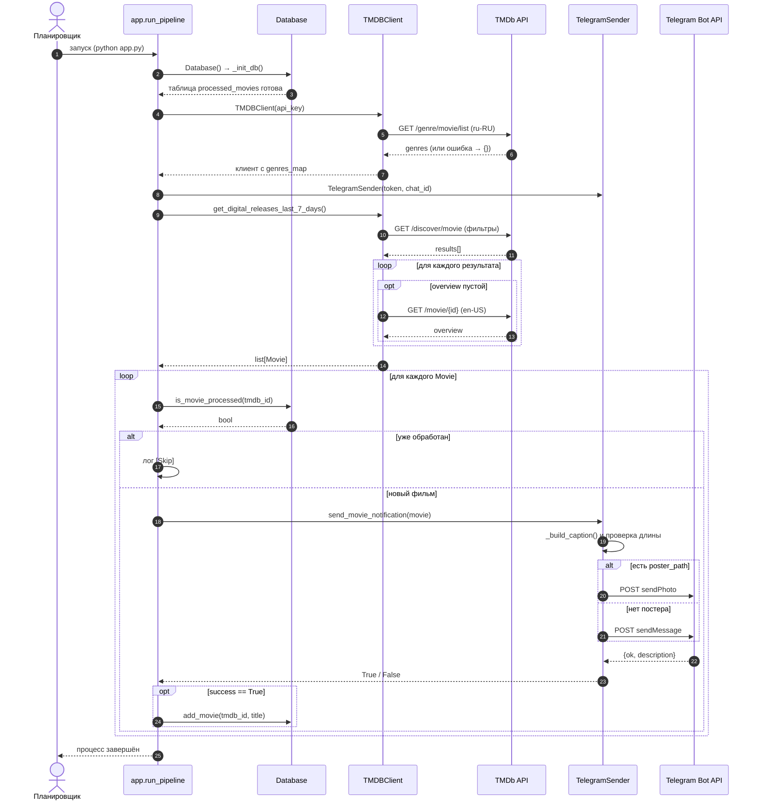

# Movie Notifier Bot

Точка входа — `app.py`, функция `run_pipeline()`. При запуске приложение инициализирует SQLite, TMDb-клиент и Telegram-отправитель, получает цифровые релизы за последние 7 дней с рейтингом не ниже 5.0, затем обрабатывает каждый фильм.

Фильм пропускается, если его `tmdb_id` уже присутствует в таблице `processed_movies`. Новый фильм отправляется в Telegram. В базу он добавляется только после успешной отправки.

TMDb-клиент загружает справочник жанров при создании объекта. Если у фильма отсутствует русскоязычное описание, выполняется дополнительный запрос за английским описанием.

Telegram-отправитель использует `sendPhoto`, если у фильма есть постер, иначе `sendMessage`.

| Компонент | Ответственность |
|---|---|
| `app.py` | оркестрация: инициализация, цикл по фильмам, дедупликация, логирование |
| `config.py` | переменные окружения `TMDB_API_KEY`, `TELEGRAM_BOT_TOKEN`, `TELEGRAM_CHAT_ID` |
| `tmdb.client` | запросы к TMDb, маппинг JSON → `Movie`, жанры, фоллбэк описания |
| `tmdb.models` | DTO `Movie` — общий контракт между клиентом и отправителем |
| `telegram_bot.sender` | формирование безопасного HTML-caption, `sendPhoto` / `sendMessage` |
| `database.db` | учёт обработанных фильмов (`processed_movies`, `tmdb_id UNIQUE`) |
| `search` | поиск раздач на Kinozal (отключён) |

Зависимости: внешние библиотеки — `requests`, `python-dotenv`, (`beautifulsoup4` для `search.py`, нет в `requirements.txt`).
